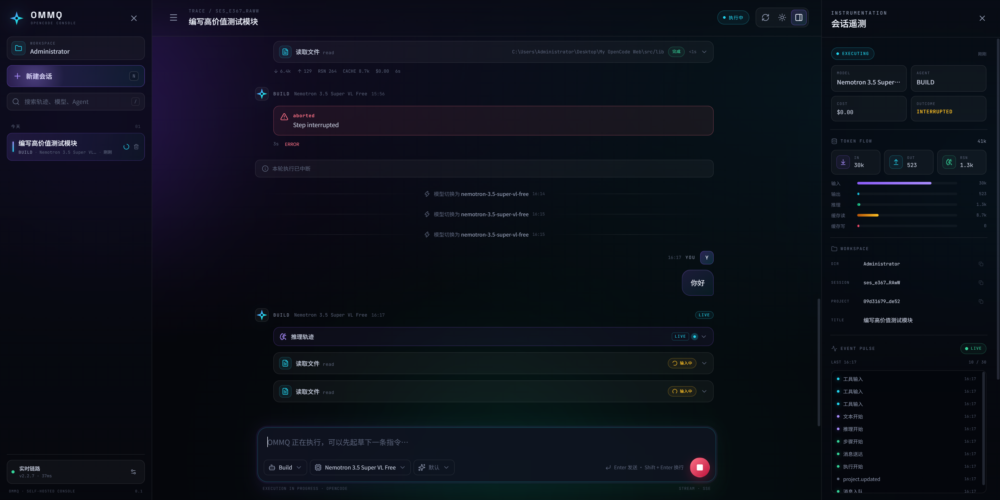

# OMMQ · OpenCode Console

> 一个为 [OpenCode](https://opencode.ai) Server 打造的自托管 Web 控制台。

不修改本体，也不接管你的数据。它是一个独立的前端，直接通过 `@opencode/client` 连接你已经在运行的 OpenCode Server，把会话、流式回复、工具轨迹、权限审批与 Token 遥测收进同一块界面。



## 特性

- **本机直接打开**：本机访问 `127.0.0.1` 时由内置代理自动完成认证，首次打开直接进入控制台，不需要填写连接表单。
- **实时事件流**：基于 SSE 增量刷新，推理、工具输入与文本逐帧抵达，断线自动降级为轮询。
- **完整会话工作台**：会话搜索、创建、切换、自动命名，按工作区目录隔离。
- **工具轨迹**：终端、文件读写、检索等工具调用以可折叠卡片呈现 INPUT / OUTPUT 与耗时。
- **权限控制台**：工具调用进入右下角授权队列，支持「允许一次 / 始终允许 / 拒绝」，不静默越权。
- **遥测面板**：模型、执行状态、Token 输入/输出/推理、缓存命中、成本与最近事件流。
- **双主题**：深空（默认）与晨光，跟随本地偏好持久化。
- **响应式布局**：桌面三栏，平板抽屉侧栏，手机底部 Sheet 弹窗与全屏遥测。
- **零业务后端**：纯静态构建，没有数据库与业务服务；连接信息仅保存在浏览器本地。

## 技术栈

React 19 · TypeScript · Vite 8 · `@opencode/client` · lucide-react ·
react-markdown + remark-gfm · Space Grotesk / Inter / JetBrains Mono。

## 快速开始

### 1. 环境要求

- Node.js 20+（推荐 22/24）
- 一个可访问的 OpenCode Server `2.2.x`
- 现代浏览器（Chrome / Edge / Safari / Firefox）

### 2. 准备 OpenCode Server

桌面版通常已在后台以 `serve --service` 模式运行，并监听本机端口（例如 `28894`）。也可以手动启动：

```bash
opencode serve --hostname 0.0.0.0 --port 28894
```

服务密码保存在：

```text
Windows  %USERPROFILE%\.config\opencode\service.json
macOS    ~/.config/opencode/service.json
Linux    ~/.config/opencode/service.json
```

也可以通过 `opencode pair` 生成一次性配对链接，或在启动日志中确认实际端口。
OMMQ 使用 Basic Auth：用户名固定为 `opencode`，密码即上述服务凭据。

### 3. 安装与启动

```bash
npm install
npm run dev -- --port 5199
```

本机浏览器打开 `http://127.0.0.1:5199`（或 `http://localhost:5199`）。只要代理能读到本机服务密码，就会直接进入控制台。

首次打开时，前端先探测同源的 `/api/info`。开发/预览代理会为 **loopback 请求**注入
`service.json` 中的 Basic Auth，因此：

- 不需要填写连接表单；
- 密码不会写入 `localStorage` / `sessionStorage`，也不会出现在页面或前端代码里；
- 日常刷新、重启浏览器仍然是直接打开。

### 4. 连接表单（回退模式）

以下情况会显示连接页，需要手动填写：

- 通过局域网地址访问（如 `http://192.168.0.100:5199`）；
- 代理读不到 `service.json`，或代理目标不是本机；
- 启动时设置了 `OPENCODE_PROXY_AUTH=0`；
- 页面由普通静态服务器托管，而不是 `npm run dev` / `npm run preview`；
- 在当前标签页点击过「断开连接」，或服务端拒绝了已保存的密码。

| 字段 | 说明 |
| --- | --- |
| 服务器地址 | 代理模式下填前端自身的地址（如 `http://127.0.0.1:5199`）。本机自动打开时通常无需填写。 |
| 访问密码 | 回退模式下填 `service.json` 中的密码；本机自动认证不需要。 |
| 工作区目录 | 会话所属目录，如 `C:\Users\you\project`。留空则使用服务器默认目录。 |
| 记住密码 | 开启时写入 `localStorage`，关闭时仅保存在 `sessionStorage`。自动打开模式不使用该项。 |

## 连接方式

### A. 本机直接打开（推荐）

本机启动开发或预览服务器后，直接打开前端地址即可：

```text
http://127.0.0.1:5199
```

代理在转发 `/api` 时会自动补上 Basic Auth，但只有在以下条件同时满足时才会注入：

1. 代理目标本身是 loopback 地址（默认 `127.0.0.1:28894`）；
2. TCP 对端是 loopback，即请求确实来自本机；
3. 请求的 `Host` 是 `127.0.0.1` / `localhost` / `[::1]`；
4. 请求不是跨站请求，且 `Origin` 与 `Host` 同源；
5. 浏览器没有自带 `Authorization`。

自动打开模式下，密码只存在于 Vite 进程内存和转发给上游的请求头里，不会下发到浏览器。

需要覆盖密码来源时（例如 `service.json` 不在默认位置）：

```powershell
# PowerShell
$env:OPENCODE_PASSWORD = '你的服务密码'
npm run dev -- --port 5199
```

```bash
# macOS / Linux
OPENCODE_PASSWORD='你的服务密码' npm run dev -- --port 5199
```

`OPENCODE_PASSWORD` 的优先级高于 `service.json`，适合服务重启后密码变化、或密码文件不可读的情况。

需要关闭自动注入（例如在它前面加了自己的认证网关）：

```powershell
$env:OPENCODE_PROXY_AUTH = "0"
npm run dev -- --port 5199
```

关闭后本机也会回到连接页。修改环境变量或 `service.json` 后需要重启 Vite 进程。

### B. 代理模式（局域网 / 远程）

开发/预览服务器内置了一个 `/api` 反向代理，规避浏览器 CORS 与 SSE 跨域限制：

```text
浏览器 ── /api/* ──▶ Vite (5199) ──▶ OpenCode Server (28894)
```

- 服务器地址填 `http://127.0.0.1:5199`（当前前端地址）。
- 代理目标默认 `http://127.0.0.1:28894`，可用 `OPENCODE_SERVER` 覆盖：

```powershell
# PowerShell
$env:OPENCODE_SERVER = "http://192.168.0.100:28894"
npm run dev -- --host 0.0.0.0 --port 5199
```

```bash
# macOS / Linux
OPENCODE_SERVER=http://192.168.0.100:28894 npm run dev -- --host 0.0.0.0 --port 5199
```

局域网设备访问 `http://192.168.0.100:5199` 时不会获得 loopback 注入，需要在连接页输入
`service.json` 中的密码。密码会经代理转发给 OpenCode Server，不会出现在 URL 中。

> 代理实现位于 `vite.config.ts`。没有使用 Vite 自带的 `http-proxy`，因为它复用连接时
> 会被 OpenCode Server 随机重置（`ECONNRESET` / 502）。当前实现基于原生 `fetch`
> 的 keep-alive 连接池，并能把 SSE 流原样透传。

### C. 直连模式

服务器地址直接填 `http://127.0.0.1:28894`。浏览器会跨域请求，需要为 OpenCode Server
显式放行前端来源：

```bash
opencode serve --cors http://127.0.0.1:5199
```

若使用 `opencode serve` 的默认 CORS 策略，直连可能被浏览器拦截，此时请使用代理模式。
直连目标没有代理注入，始终需要在连接页填写密码。

## 生产部署

### 使用内置预览服务器

`npm run preview` 同样带有 `/api` 代理和本机自动认证，适合内网长期运行：

```bash
npm run build
npm run preview -- --host 0.0.0.0 --port 5199
```

行为与开发服务器一致：部署机本机直接打开，局域网设备回退到连接页。

### 静态托管 + 反向代理

`dist/` 是纯静态站点。部署到 Nginx/Caddy 时，把 `/api/` 反代到 OpenCode Server，
并关闭响应缓冲以支持 SSE。静态托管默认没有自动注入，因此会显示连接页。Nginx 示例：

```nginx
server {
  listen 80;
  server_name OMMQ.local;
  root /var/www/OMMQ;
  index index.html;

  location /api/ {
    proxy_pass http://127.0.0.1:28894/api/;
    proxy_http_version 1.1;
    proxy_set_header Host $host;
    proxy_set_header Authorization $http_authorization;
    proxy_buffering off;
    proxy_cache off;
    proxy_read_timeout 3600s;
  }

  location / {
    try_files $uri /index.html;
  }
}
```

随后在连接页把服务器地址填为 `http://OMMQ.local`，并输入 OpenCode 服务密码。

如果希望部署机本机也直接打开，可以只在 loopback 来源上注入 Basic Auth。**这会把凭据
写进 Nginx 配置，请限制配置文件权限。** 在 `http` 上下文加入：

```nginx
geo $OMMQ_loopback {
  default 0;
  127.0.0.1/32 1;
  ::1/128 1;
}

map "$OMMQ_loopback:$http_authorization" $OMMQ_authorization {
  "1:" "Basic <BASE64(opencode:密码)>";
  default $http_authorization;
}
```

然后把 `location /api/` 中的授权头改为：

```nginx
proxy_set_header Authorization $OMMQ_authorization;
```

`<BASE64(opencode:密码)>` 用下面的命令生成（不要带换行）：

```bash
printf 'opencode:%s' '你的服务密码' | base64
```

这样 loopback 请求会得到注入，局域网请求仍使用自己提交的密码。若 Nginx 前面还有一层
代理，请正确配置 `set_real_ip_from` / `real_ip_header`，否则 `geo` 判断会失真。

### 构建默认地址

如需在构建时预填连接页的服务器地址（生产环境默认是 `http://127.0.0.1:28894`）：

```bash
VITE_OPENCODE_SERVER=https://opencode.example.com npm run build
```

这个值只用于连接页预填；本机自动打开仍然取决于当前页面 origin 是否有可用的 `/api` 代理。

## 配置项

| 变量 | 作用域 | 默认值 | 说明 |
| --- | --- | --- | --- |
| `OPENCODE_SERVER` | Vite 进程 | `http://127.0.0.1:28894` | 开发/预览代理的目标地址 |
| `OPENCODE_PASSWORD` | Vite 进程 | 读取 `service.json` | 覆盖本机代理注入用的密码 |
| `OPENCODE_PROXY_AUTH` | Vite 进程 | 启用 | 设为 `0` 关闭 loopback 自动认证 |
| `VITE_OPENCODE_SERVER` | 构建产物 | 开发时为前端 origin，生产为 `http://127.0.0.1:28894` | 连接页预填的服务器地址 |

## 安全说明

OMMQ 的能力等同于你授予 OpenCode 的能力，请把它当成一台可以执行命令的开发机：

- **本机自动认证是信任边界。** 任何能访问 `127.0.0.1:5199` 的本机进程或用户都可以无密码
  调用 `/api`，等同于本机直接访问 OpenCode。不要把 `5199` 端口暴露到公网。
- **不要在自动注入的代理前面再套反向代理。** 从本机反向代理转发进来的请求可能被当作
  loopback。若必须这样做，先设置 `OPENCODE_PROXY_AUTH=0`，并在反向代理层完成认证。
- Basic Auth 只是 Base64 编码，**不是加密**。跨机器访问请务必套 HTTPS 反向代理，不要把
  `5199` 或 OpenCode 端口直接暴露到公网。
- 手动连接并开启「记住密码」时，服务密码会明文写入 `localStorage`。共享设备上请关闭该
  选项；自动打开模式不会把密码写入浏览器。
- 代理会原样转发请求头，任何能访问前端代理的人都可以尝试连接 OpenCode Server；请配合
  强密码、内网 ACL 或额外的网关认证。
- 工具授权会真实执行终端命令与文件写入。「始终允许」会对同类请求持续放行，请谨慎使用。
- OMMQ 自身没有业务后端，也不上传数据；所有会话内容只存在于 OpenCode Server。

## 工作原理

```text
src/
├─ App.tsx                  # 应用编排：视图、弹窗、抽屉与焦点会话
├─ hooks/useOMMQ.ts         # 连接、自动打开、会话/消息加载、SSE、权限、Toast
├─ lib/                     # SDK 客户端、错误映射、本地存储、格式化
├─ components/              # 连接页、侧栏、时间线、输入器、遥测、权限队列…
└─ styles/                  # 设计令牌、外壳、对话、面板
```

- **本机自动打开**：首次启动探测同源 `/api/info`，成功后以当前 origin 作为服务器地址、
  密码留空，由代理注入认证；探测失败则显示连接页。
- **消息刷新**：SSE 事件触发去抖 160ms 的消息重取，避免本地增量合并产生漂移；
  SSE 断开时每 5s 轮询兜底。
- **消息上限**：OpenCode Server 单次最多返回 200 条消息，前端按此上限加载。
- **会话隔离**：列表与会话创建均携带 `directory` 参数，与 OpenCode 的工作区语义一致。
- **遥测回退**：会话未记录模型时，使用最后一条 assistant 消息的模型信息。
- **认证失效**：收到 401 时清除浏览器中的密码，保留地址与工作区，并回到连接页。

## 脚本

| 命令 | 说明 |
| --- | --- |
| `npm run dev` | 启动开发服务器（含 `/api` 代理与本机自动认证） |
| `npm run build` | 类型检查并构建到 `dist/` |
| `npm run preview` | 预览构建产物（含 `/api` 代理与本机自动认证） |
| `npm run lint` | 运行 oxlint |

## 常见问题

**本机打开为什么没有连接页？** 这是本机直接打开模式：代理从 `service.json` 读取密码，
只为 loopback 请求注入 Basic Auth，前端探测成功后自动进入控制台。

**本机也出现连接页？** 依次检查：`service.json` 是否存在且可读；`OPENCODE_SERVER` 是否是
本机地址；是否设置了 `OPENCODE_PROXY_AUTH=0`；页面是否由 `npm run dev` / `npm run preview`
提供。也可以直接填写密码连接，或在设置中重新连接。

**局域网访问需要密码吗？** 需要。局域网请求没有 loopback 注入，请在连接页输入
`service.json` 中的密码。启动时加 `--host 0.0.0.0` 才能让局域网访问。

**连接失败 / 401？** 确认服务器地址与密码正确。代理模式下地址应填前端地址而非
OpenCode 端口；`401` 表示密码错误，`502` 通常表示代理目标不可达。自动打开模式出现 401
通常是 OpenCode 服务重启后密码已变化，更新 `service.json` 或 `OPENCODE_PASSWORD` 后重启
Vite。

**页面能打开但没有会话？** 检查「工作区目录」是否与 OpenCode 中会话所属目录一致；
目录不同会得到不同的会话列表。

**回复不刷新？** 检查浏览器 Network 中 `/api/event` 是否保持 `text/event-stream`；
若被代理缓冲，请关闭 Nginx 的 `proxy_buffering`。

**模型报 `Insufficient account funds`？** 这是模型提供方的额度问题，与前端无关；
在新建会话中选择其他可用模型即可。
